<!--
  GITHUB PROFILE README — NEON MINT TEMPLATE
  1. Create a PUBLIC repository named exactly like your GitHub username.
  2. Upload README.md and the entire assets/ folder.
  3. Replace YOUR NAME / YOUR ROLE / YOUR SPECIALIZATION and the other placeholders.
  4. To change theme colors, replace #76F7D5 (accent) and #071117 (background) in assets/*.svg.
  No external generators, API tokens, or GitHub Actions required.
-->

<div align="center">
  
</div>

<br />

<div align="center">
  
</div>

<br />

### `> about_me`

Hi! I'm **YOUR NAME**, a **YOUR ROLE** interested in **YOUR FOCUS / INTERESTS**.

I enjoy learning new things, experimenting with technology and building thoughtful solutions.

- 🔭 **Currently exploring:** YOUR CURRENT TOPIC
- 🌱 **Learning:** YOUR NEXT SKILL
- ⚡ **Into:** YOUR INTERESTS

### `> tech_stack`

<!-- Delete or replace anything you don't actually use. -->


### `> current_status`

```text
[ SYSTEM INITIALIZED ]
[ PROJECTS LOADING  ]
[ NEW IDEAS: ONLINE ]
```

<!--
  ADD THIS SECTION WHEN YOU HAVE PROJECTS TO SHOW:

### `> selected_projects`

| Project | What it does | Stack |
| :-- | :-- | :-- |
| [Project name](https://github.com/YOUR_USERNAME/PROJECT) | Short description | Python, ... |

  ADD THESE CONTACT LINKS ONLY WHEN YOU WANT THEM PUBLIC:

### `> connect`

[LinkedIn](https://linkedin.com/in/YOUR_LINK) · [Website](https://YOUR_WEBSITE)
-->

<br />

<div align="center">
  
</div>
